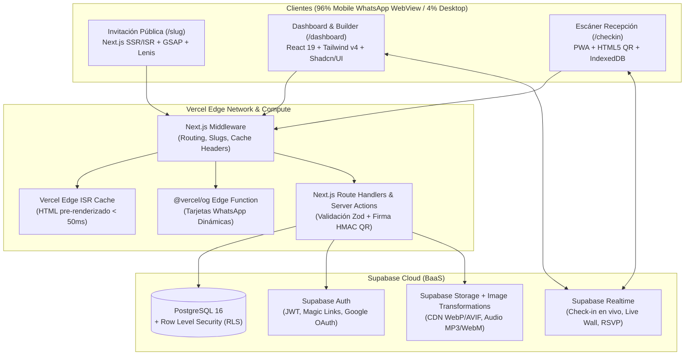
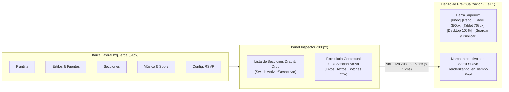

# SPEC.md — Especificación Técnica y de Producto: Plataforma de Invitaciones Digitales Interactivas Premium

**Versión:** 1.0.0  
**Estado:** Especificación Definitiva (Ready for Engineering)  
**Arquitectura Objetivo:** Next.js 15 (App Router) + TypeScript + Supabase (PostgreSQL, Auth, Storage, Realtime) + GSAP / Lenis / Framer Motion  

---

## Tabla de Contenidos

1. [Visión General del Producto y Benchmarking de Mercado](#1-visión-general-del-producto-y-benchmarking-de-mercado)
2. [Features Diferenciadoras ("Killer Features" frente a la Competencia)](#2-features-diferenciadoras-killer-features-frente-a-la-competencia)
3. [Infraestructura y Stack Tecnológico Recomendado](#3-infraestructura-y-stack-tecnológico-recomendado)
4. [Arquitectura del Sistema y Estructura del Proyecto](#4-arquitectura-del-sistema-y-estructura-del-proyecto)
5. [Especificación Frontend — Módulo 1: Dashboard Administrativo y Constructor Visual](#5-especificación-frontend--módulo-1-dashboard-administrativo-y-constructor-visual)
6. [Especificación Frontend — Módulo 2: Motor de Invitaciones Públicas y Secciones Modulares](#6-especificación-frontend--módulo-2-motor-de-invitaciones-públicas-y-secciones-modulares)
7. [Motor de Animaciones Scrollytelling y Experiencia Interactiva](#7-motor-de-animaciones-scrollytelling-y-experiencia-interactiva)
8. [Catálogo Detallado de los 10 Templates Iniciales](#8-catálogo-detallado-de-los-10-templates-iniciales)
9. [Sistema de URLs Personalizadas, Enrutamiento y SEO/WhatsApp Preview](#9-sistema-de-urls-personalizadas-enrutamiento-y-seowhatsapp-preview)
10. [Diseño 100% Responsive y Presupuesto de Optimización (Performance Budget)](#10-diseño-100-responsive-y-presupuesto-de-optimización-performance-budget)
11. [Especificación Backend — Esquema de Base de Datos (PostgreSQL + RLS)](#11-especificación-backend--esquema-de-base-de-datos-postgresql--rls)
12. [Especificación Backend — Contratos de API, Validación y Flujos Críticos](#12-especificación-backend--contratos-de-api-validación-y-flujos-críticos)
13. [Seguridad, Almacenamiento Multimedia y Plan de Despliegue](#13-seguridad-almacenamiento-multimedia-y-plan-de-despliegue)
14. [Roadmap de Implementación por Fases](#14-roadmap-de-implementación-por-fases)

---

## 1. Visión General del Producto y Benchmarking de Mercado

### 1.1 Contexto del Mercado Actual
Las invitaciones digitales han reemplazado a la papelería impresa tradicional, especialmente en Latinoamérica, España y EE. UU., donde **WhatsApp es el canal de distribución del 96% de los eventos sociales** (Bodas, XV Años, Bautizos, Cumpleaños, Baby Showers, Graduaciones).

Tras analizar a los principales competidores del mercado (*Invitio, PartyPass, Fiestly, InvítameOK, WithJoy, Zola y diseños en Canva*), se identifican lo que ofrecen actualmente y sus limitaciones técnicas:

| Característica | Qué ofrece la competencia promedio | Limitación / Problema detectado en la competencia |
| :--- | :--- | :--- |
| **Diseño y Animaciones** | Páginas hechas en constructores tipo WordPress/Elementor o Canva con animaciones CSS básicas (`fade-in`). | Se sienten como plantillas genéricas o blogs; sufren de *jank* (caídas de FPS) al hacer scroll en celulares de gama media. |
| **Tiempos de Carga** | Cargan imágenes PNG/JPG sin comprimir de 5 MB a 15 MB y archivos MP3 completos al inicio. | Tardan de 6 a 12 segundos en abrir dentro del navegador interno de WhatsApp con datos móviles (4G). |
| **URLs e Invitados** | Un único link genérico (`dominio.com/mi-evento`) donde cualquier persona escribe su nombre y elige cuántos boletos quiere. | Invitados que tenían asignados 2 pases se registran con 5 acompañantes; no hay control real del cupo por familia. |
| **Confirmación (RSVP)** | Muchos redirigen a un mensaje de texto de WhatsApp manual o a un Google Forms externo. | El organizador termina transcribiendo mensajes de WhatsApp manualmente a un Excel la semana previa al evento. |
| **Previsualización en WhatsApp** | Meta tags estáticos o sin imagen OpenGraph personalizada. | Al pegar el link en WhatsApp aparece un recuadro gris o el logo de la empresa en lugar de la foto y nombres de los festejados. |
| **Día del Evento** | La invitación muere en cuanto empieza la fiesta. | No aporta valor durante la recepción (control de acceso lento, sin interacción con fotos en vivo ni asignación de mesas). |

### 1.2 Objetivo de la Aplicación
Construir una plataforma web **SaaS / Agencia Híbrida** que permita crear, administrar y distribuir invitaciones digitales interactivas con **calidad de estudio de diseño boutique (Scrollytelling a 60fps)**, **carga instantánea en el Edge (< 1.5s)** y un **sistema integral de gestión de invitados, pases QR y experiencias en vivo**.

La arquitectura soporta dos modos de operación simultáneos mediante control de roles:
1. **Modo Agencia / Concierge (Admin):** Un administrador crea y personaliza las invitaciones para sus clientes y les comparte un acceso de "Anfitrión (Host)" para que vean sus confirmaciones, gestionen su lista de invitados y descarguen sus pases.
2. **Modo Autoservicio (Self-Service SaaS):** El cliente final se registra, elige uno de los 10+ templates, sube sus fotos, personaliza textos/colores/música y publica su URL personalizada.

---

## 2. Features Diferenciadoras ("Killer Features" frente a la Competencia)

Para posicionar el producto muy por encima del estándar del mercado, la plataforma incorpora **7 diferenciadores clave**:

### 2.1 Hiper-Personalización por Familia/Invitado (Smart Guest Links)
Además de la URL pública general (`dominioprincipal.com/boda-sofia-mateo`), el dashboard genera enlaces únicos por grupo familiar (`dominioprincipal.com/boda-sofia-mateo?g=fam-garcia-8a2f`):
* **Sobre Digital Nominal:** Al abrir el enlace, el sello de lacre y la portada del sobre muestran dinámicamente: *"Para: Familia García López — Pase válido por 4 Adultos y 1 Niño"*.
* **Bloqueo Estricto de Cupo:** El formulario de confirmación (RSVP) carga pre-llenado con los nombres de los integrantes de esa familia o limita el selector numérico exactamente al máximo de pases asignados (imposibilitando que confirmen personas extra no invitadas).

### 2.2 Pase Digital Criptográfico + Escáner de Recepción Offline-First (Hostess Mode)
* **Generación Automática de Pase:** En el instante en que el invitado confirma su asistencia, la invitación genera en pantalla un **Pase de Acceso VIP descargable en PNG/PDF** (y compatible con *Apple Wallet / Google Wallet* en fases posteriores) con un código QR firmado criptográficamente (`HMAC-SHA256`).
* **Web App de Check-in en Puerta:** Incluye la ruta `/dashboard/events/[id]/checkin` optimizada para la cámara del celular de la *hostess* o *wedding planner*. Permite escanear el QR del invitado en < 300ms, indica cuántas personas ingresan, muestra su **número de mesa asignada** y sincroniza en segundo plano incluso si el salón o jardín tiene mala recepción celular (`IndexedDB` + sincronización).

### 2.3 Tarjetas OpenGraph Dinámicas para WhatsApp (`@vercel/og`)
Cada invitación genera automáticamente en el servidor una imagen miniatura (`1200x630px`) con la foto principal de los festejados, su tipografía elegida y la fecha del evento. Si se comparte un link personalizado (`?g=fam-garcia`), la miniatura de WhatsApp renderiza: *"Familia García: Están cordialmente invitados a los XV Años de Valentina"*, logrando un impacto visual inmediato en el chat.

### 2.4 "Audio Guestbook" (Libro de Firmas Vocal)
En lugar del tradicional muro de solo texto, los invitados pueden mantener presionado un botón tipo nota de voz directamente en la invitación (usando la API nativa `MediaRecorder` del navegador) para grabar un mensaje de felicitación de hasta 45 segundos para los novios o la quinceañera. Los anfitriones pueden escuchar y descargar todos los audios desde su dashboard en un recuerdo emotivo.

### 2.5 "Live Disposable Camera" (Cámara Desechable Digital el Día del Evento)
Configurada por fecha/hora: cuando llega el día del evento, se activa en la misma invitación un botón flotante **"Cámara en Vivo del Evento"**.
* Los invitados toman fotografías desde la invitación con un filtro estético opcional (Vintage Film, Blanco y Negro Editorial, Warm Glow).
* Las fotos se suben en tiempo real al álbum del evento y pueden proyectarse en vivo en una pantalla del salón mediante la vista `/dashboard/events/[id]/live-wall` (con moderación opcional desde el celular de los anfitriones).

### 2.6 DJ Request & Votación de Canciones en Tiempo Real
Integración con búsqueda de canciones (vía API pública de iTunes/Spotify Search sin requerir login del invitado) donde los asistentes buscan qué canción no puede faltar en la fiesta, ven la carátula del álbum, escuchan un preview de 30s y pueden dar "Upvote" (corazón) a las canciones sugeridas por otros invitados. El dashboard exporta el Top 50 directamente para el DJ del evento.

### 2.7 Organizador Visual de Mesas (Drag & Drop Seating Chart)
Dentro del dashboard, los anfitriones crean mesas (redondas, rectangulares o mesa de honor), definen su capacidad (8, 10, 12 personas) y arrastran a los invitados confirmados hacia cada mesa, detectando automáticamente alergias alimentarias o sillas de niños por mesa.

---

## 3. Infraestructura y Stack Tecnológico Recomendado

### 3.1 Comparativa de BaaS: ¿Por qué Supabase sobre Firebase?

| Criterio Técnico | Supabase (PostgreSQL) — **RECOMENDADO** | Firebase (Firestore) |
| :--- | :--- | :--- |
| **Modelo de Datos** | **Relacional (PostgreSQL).** Ideal para modelar Eventos $\rightarrow$ Grupos de Invitados $\rightarrow$ Invitados Individuales $\rightarrow$ Mesas $\rightarrow$ Confirmaciones RSVP con integridad referencial (`FOREIGN KEY`). | **NoSQL Documental.** Requiere desnormalización compleja para cruzar invitados con mesas y calcular estadísticas agregadas de platillos/asistencia. |
| **Transacciones y Concurrencia** | **Transacciones ACID nativas y funciones RPC.** Garantiza que un pase QR no sea escaneado dos veces simultáneamente ni se exceda la capacidad de una mesa. | Limitado a operaciones transaccionales por documento con costos adicionales de lectura. |
| **Costos en Tráfico Viral (WhatsApp)** | **Predecible por cómputo/ancho de banda.** Combinado con ISR de Next.js, miles de aperturas en grupos de WhatsApp cuestan prácticamente \$0 USD adicionales. | **Cobro por lectura de documento.** Si una invitación con 20 sub-documentos se abre 10,000 veces, genera 200,000 lecturas facturables. |
| **Seguridad Granular** | **Row Level Security (RLS) en SQL.** Políticas declarativas exactas por rol (`admin`, `host`, `public`). | Reglas propietarias de Firestore que se vuelven difíciles de mantener en relaciones profundas. |

### 3.2 Stack Definitivo Frontend, Backend e Infraestructura



#### Detalle de Librerías y Versiones Exactas Recomendadas
* **Framework Core:** `next@^15.2.0` (App Router, Server Components, Server Actions, Incremental Static Regeneration), `react@^19.0.0`, `typescript@^5.7.0`.
* **Estilos y Sistema de Diseño:** `tailwindcss@^4.0.0`, `@radix-ui/*` (vía `shadcn/ui`), `lucide-react` (iconografía limpia), `clsx`, `tailwind-merge`.
* **Motor de Animaciones y Scrollytelling:**
  * `gsap@^3.12.5` + `@gsap/react@^2.1.1` (Coreografías `ScrollTrigger`, timelines de apertura de sobre, revelados de máscaras SVG, parallax de capas).
  * `lenis@^1.1.18` (Smooth Scroll inercial sincronizado con `gsap.ticker`).
  * `motion@^12.0.0` (Framer Motion para transiciones de modales, tabs del dashboard, acordeones y micro-interacciones de UI).
  * `canvas-confetti@^1.9.3` (Efectos de celebración al confirmar asistencia o abrir sobre).
* **Estado, Formularios y Validación:**
  * `zustand@^5.0.0` + `zundo` (Estado global del Builder de invitaciones con soporte nativo de `Undo/Redo`).
  * `react-hook-form@^7.54.0` + `zod@^3.24.0` + `@hookform/resolvers` (Validación compartida entre Frontend y Backend).
  * `@dnd-kit/core`, `@dnd-kit/sortable` (Reordenamiento de secciones en el Builder y asignación de invitados a mesas).
* **Multimedia, QR y Utilidades:**
  * `howler@^2.2.4` (Control robusto de audio en móviles iOS/Android con fade-in/fade-out y manejo de bloqueo de autoplay).
  * `qrcode.react@^4.2.0` (Generación de QR en cliente) + `html5-qrcode` / `@yudiel/react-qr-scanner` (Lector QR con cámara en recepción).
  * `html-to-image@^1.11.11` (Exportación del Pase VIP con QR como imagen PNG descargable en el celular del invitado).
  * `papaparse@^5.4.1` (Importación y exportación masiva de listas de invitados en CSV).
  * `date-fns@^4.1.0` + `@date-fns/tz` (Manejo exacto de zonas horarias para la cuenta regresiva y generación de calendarios `.ics`).

---

## 4. Arquitectura del Sistema y Estructura del Proyecto

El repositorio seguirá una arquitectura modular y tipada de extremo a extremo dentro de un único proyecto Next.js 15:

```text
invitacionesdigitales/
├── public/
│   ├── textures/                     # Texturas de papel algodón, lino, grano cinematográfico y sellos de lacre
│   ├── audio/                        # Pistas instrumentales libres de regalías pre-cargadas por categoría
│   └── icons/                        # SVG optimizados de dress code, copas, anillos, coronas, iglesia
├── src/
│   ├── app/
│   │   ├── (marketing)/              # Landing page comercial, catálogo público de demos de los 10 templates
│   │   │   ├── page.tsx
│   │   │   └── demos/[templateId]/page.tsx
│   │   ├── (auth)/                   # Login, Registro, Magic Link, Recuperación de contraseña
│   │   │   ├── login/page.tsx
│   │   │   └── register/page.tsx
│   │   ├── (dashboard)/              # Panel de Administración (Protegido por Middleware Auth)
│   │   │   └── dashboard/
│   │   │       ├── layout.tsx
│   │   │       ├── page.tsx                          # Métricas globales y resumen de eventos
│   │   │       └── events/
│   │   │           ├── new/page.tsx                  # Wizard de creación rápida en 3 pasos
│   │   │           └── [eventId]/
│   │   │               ├── page.tsx                  # Resumen del evento (KPIs de RSVP, gráficas)
│   │   │               ├── builder/page.tsx          # Editor Visual en Vivo (Split-screen)
│   │   │               ├── guests/page.tsx           # CRM de Invitados, links únicos y envíos WhatsApp
│   │   │               ├── seating/page.tsx          # Mapa de Mesas Drag & Drop
│   │   │               ├── checkin/page.tsx          # Escáner QR para recepción el día del evento
│   │   │               ├── memories/page.tsx         # Moderación de fotos y Audio Guestbook
│   │   │               ├── live-wall/page.tsx        # Modo Proyector en Vivo para pantalla del salón
│   │   │               └── settings/page.tsx         # Dominio/Slug, SEO, co-anfitriones, privacidad
│   │   ├── (invitation)/             # Renderizador Público Ultra-Optimizado (ISR + Edge)
│   │   │   └── [slug]/
│   │   │       ├── page.tsx                          # Página pública de la invitación (?g=guestToken)
│   │   │       ├── opengraph-image.tsx               # Generador dinámico de miniatura para WhatsApp
│   │   │       └── not-found.tsx                     # Pantalla elegante cuando una invitación no existe/expiró
│   │   └── api/
│   │       ├── events/
│   │       │   ├── route.ts                          # Creación y listado de eventos
│   │       │   └── [eventId]/
│   │       │       ├── route.ts                      # Actualización de configuración + revalidatePath()
│   │       │       └── export-csv/route.ts           # Descarga de lista de confirmados y mesas
│   │       ├── public/
│   │       │   └── invitations/[slug]/
│   │       │       ├── rsvp/route.ts                 # Procesamiento transaccional de RSVP + firma QR
│   │       │       ├── songs/route.ts                # Sugerencia y votación de canciones
│   │       │       └── media/route.ts                # Firma de URLs para subir fotos o notas de voz
│   │       └── checkin/
│   │           └── verify/route.ts                   # Verificación criptográfica de QR y registro de entrada
│   ├── components/
│   │   ├── dashboard/                # Componentes del panel administrativo (Tablas, Sidebar, Modales)
│   │   ├── builder/                  # Controles del editor (ColorPicker, FontSelector, SectionSorter, ViewportFrame)
│   │   ├── invitation/               # Motor de renderizado de invitaciones
│   │   │   ├── core/
│   │   │   │   ├── InvitationRenderer.tsx            # Orquestador que conecta el Template con los Datos
│   │   │   │   ├── SmoothScrollProvider.tsx          # Wrapper de Lenis + GSAP ScrollTrigger
│   │   │   │   ├── EnvelopeOpener.tsx                # Sobre interactivo 3D/Canvas con sello de lacre
│   │   │   │   └── FloatingAudioPlayer.tsx           # Controlador Howler.js flotante
│   │   │   ├── sections/             # Los 13 bloques funcionales modulares
│   │   │   │   ├── HeroSection.tsx
│   │   │   │   ├── QuoteStorySection.tsx
│   │   │   │   ├── CountdownSection.tsx
│   │   │   │   ├── VipParentsGodparentsSection.tsx
│   │   │   │   ├── LocationsSection.tsx
│   │   │   │   ├── TimelineSection.tsx
│   │   │   │   ├── GallerySection.tsx
│   │   │   │   ├── DressCodeSection.tsx
│   │   │   │   ├── GiftsSection.tsx
│   │   │   │   ├── AccommodationSection.tsx
│   │   │   │   ├── SongRequestSection.tsx
│   │   │   │   ├── AudioGuestbookSection.tsx
│   │   │   │   └── RsvpSection.tsx
│   │   │   └── templates/            # Los 10 Templates con sus layouts, ornamentos SVG y coreografías GSAP
│   │   │       ├── EternalElegance/
│   │   │       ├── BohoTerracotta/
│   │   │       ├── ModernMinimalNoir/
│   │   │       ├── RoyalXvEnchanted/
│   │   │       ├── NeonXvEuphoria/
│   │   │       ├── GoldenJubilee/
│   │   │       ├── FiestaKidsAdventure/
│   │   │       ├── CelestialBaptism/
│   │   │       ├── SweetOhBaby/
│   │   │       └── GradGalaNight/
│   │   └── ui/                       # Primitivas de interfaz (Shadcn/UI)
│   ├── lib/
│   │   ├── supabase/
│   │   │   ├── client.ts             # Cliente navegador
│   │   │   ├── server.ts             # Cliente SSR con cookies
│   │   │   └── admin.ts              # Cliente Service Role (solo para operaciones privilegiadas de backend)
│   │   ├── schemas/
│   │   │   ├── invitation-config.schema.ts           # Esquema Zod estricto del JSON de configuración
│   │   │   ├── rsvp.schema.ts                        # Esquema Zod de confirmación de asistencia
│   │   │   └── guest.schema.ts                       # Esquema Zod de importación y gestión de invitados
│   │   ├── crypto/
│   │   │   └── qr-signer.ts          # Firma y verificación HMAC-SHA256 de pases de acceso
│   │   ├── calendar/
│   │   │   └── ics-generator.ts      # Generador de archivos .ics y links de Google/Apple Calendar
│   │   └── whatsapp/
│   │       └── link-builder.ts       # Constructor de enlaces wa.me con interpolación de variables
│   ├── stores/
│   │   └── useBuilderStore.ts        # Store Zustand del editor en vivo con Undo/Redo y estado dirty
│   └── types/
│       ├── database.types.ts         # Tipos autogenerados por Supabase CLI
│       └── invitation.types.ts       # Interfaces TypeScript del dominio de invitaciones
├── supabase/
│   └── migrations/
│       └── 0001_initial_schema.sql   # DDL completo, índices, funciones RPC y políticas RLS
└── middleware.ts                     # Protección de rutas, resolución de slugs y cabeceras de seguridad
```

---

## 5. Especificación Frontend — Módulo 1: Dashboard Administrativo y Constructor Visual

### 5.1 Flujo de Creación de una Invitación (Wizard Inicial)
Al hacer clic en **"Crear Nueva Invitación"** (`/dashboard/events/new`), el usuario completa un asistente en 3 pasos rápidos antes de entrar al constructor visual:
1. **Paso 1 — Tipo de Evento y Datos Base:**
   * Categoría: `Boda`, `XV Años`, `Cumpleaños Adulto`, `Cumpleaños Infantil`, `Bautizo / Comunión`, `Baby Shower`, `Graduación / Gala`.
   * Título principal (ej. *"Sofía & Mateo"* o *"Mis XV: Valentina"*).
   * Fecha y hora de inicio del evento + Zona Horaria (por defecto `America/Mexico_City`).
   * URL personalizada sugerida automáticamente con verificación de disponibilidad en tiempo real (debounce de 300ms): `www.dominioprincipal.com/boda-sofia-y-mateo`.
2. **Paso 2 — Selección de Template Inicial:**
   * Grilla interactiva con los 10 templates iniciales filtrables por categoría. Cada tarjeta permite abrir una previsualización animada completa antes de elegir.
3. **Paso 3 — Modalidad de Confirmación (RSVP Mode):**
   * **Modo Lista Cerrada / Pases Personalizados (Recomendado):** Solo pueden confirmar invitados con link personalizado o código de invitación, respetando el límite exacto de pases asignados.
   * **Modo Abierto con Aprobación:** Cualquier persona con el link público puede llenar el formulario RSVP indicando su nombre y número de acompañantes (hasta un tope configurable por registro, ej. máx. 4 personas).

### 5.2 El Constructor Visual en Vivo (`/dashboard/events/[eventId]/builder`)
El constructor es una interfaz **Split-Screen** de grado profesional sin recargas de página:



#### Capacidades Específicas del Constructor Visual:
1. **Selector de Plantilla en Caliente (Hot-Swap Templates):** Cambiar entre cualquiera de los 10 templates conserva el 100% de la información ingresada (nombres, fechas, fotos, ubicaciones, mesa de regalos), adaptando únicamente el diseño, tipografías, ornamentos y animaciones GSAP.
2. **Personalización Global de Diseño (Design Tokens):**
   * **Paleta de Colores:** Selección de preset del template o personalización manual de 6 tokens semánticos: `--inv-bg-primary`, `--inv-bg-secondary`, `--inv-text-primary`, `--inv-text-muted`, `--inv-accent-primary` (botones/detalles dorados o color principal), `--inv-accent-secondary`.
   * **Combinaciones Tipográficas (Font Pairings):** Selector curado de 15 combinaciones editoriales con carga optimizada desde `next/font/google` (Tipografía Display/Caligráfica para títulos + Serif Editorial para subtítulos + Sans-Serif limpia para cuerpo y botones).
   * **Textura y Efectos Ambientales:** Selector de textura de fondo (`Lino Orgánico`, `Papel Algodón`, `Grano Fino`, `Liso`) y partículas flotantes en Canvas (`Ninguna`, `Destellos Dorados`, `Pétalos Blancos`, `Estrellas Suaves`, `Confeti Festivo`).
3. **Gestor de Secciones (`@dnd-kit`):**
   * Permite prender/apagar (`enabled: boolean`) cualquiera de las 13 secciones modulares y reordenarlas arrastrando y soltando.
   * Al hacer clic en una sección en el panel izquierdo, el lienzo central hace *smooth scroll* automáticamente hacia esa sección.
4. **Recorte y Optimización de Fotos Integrado:**
   * Al subir una fotografía para el Hero o la Galería, incluye un control de punto focal (`object-position: X% Y%`) para garantizar que los rostros nunca se corten ni en pantallas verticales ni horizontales.

### 5.3 CRM de Invitados y Despacho por WhatsApp (`/dashboard/events/[eventId]/guests`)
1. **KPIs en Tiempo Real en la Cabecera:**
   * Total de Invitados en Lista (Adultos / Niños).
   * Confirmados Asistirán (Verde) | Pendientes por Responder (Ámbar) | No Asistirán (Rojo).
   * Barra de progreso de vistas de la invitación (*"Tu invitación ha sido abierta por 68 de 85 familias"*).
2. **Tabla de Grupos o Familias:**
   * Columnas: `Nombre de Familia/Grupo`, `Teléfono WhatsApp`, `Etiqueta (Novia/Novio/VIP/Trabajo)`, `Pases Adultos`, `Pases Niños`, `Estado (Pendiente / Vista / Confirmada / Declinada)`, `Confirmados Reales`, `Mesa Asignada`, `Acciones`.
3. **Acciones en 1 Clic por Fila:**
   * **Copiar Link Único:** Copia `https://www.dominioprincipal.com/boda-sofia-mateo?g=fam-lopez-9x2a`.
   * **Enviar por WhatsApp:** Abre `https://wa.me/5215512345678?text=...` con un mensaje pre-redactado personalizable:
     > *"¡Hola *Familia López*! 💍 Con mucha ilusión queremos compartir con ustedes la invitación digital a nuestra boda. Tienen reservados *4 pases de adulto*. Por favor abran su sobre personalizado y confírmennos su asistencia aquí: https://www.dominioprincipal.com/boda-sofia-mateo?g=fam-lopez-9x2a"*
   * Al hacer clic en "Enviar por WhatsApp", la fila se marca visualmente como `Enviada` con fecha y hora para que los organizadores sepan a quién ya se le mandó y a quién falta enviarle.
4. **Importador CSV / Excel:**
   * Plantilla descargable e importador con mapeo de columnas y validación previa de teléfonos duplicados.

---

## 6. Especificación Frontend — Módulo 2: Motor de Invitaciones Públicas y Secciones Modulares

Toda invitación pública se compone de una **Experiencia de Apertura (Sobre + Audio)** seguida de una secuencia de **Secciones Modulares** renderizadas por `<InvitationRenderer />`. Ningún campo opcional vacío muestra contenedores rotos; si un dato opcional no existe, el sub-componente se omite limpiamente.

### 6.1 Catálogo Completo de Bloques / Secciones y sus Props

#### Bloque 0: Sobre Interactivo de Apertura (`EnvelopeOpener`)
* **Propósito:** Crear un primer impacto memorable y capturar el primer clic/tap del usuario (indispensable para que iOS Safari y Chrome Android permitan reproducir la música de fondo sin bloquear el audio).
* **Variantes Visuales:**
  1. `wax-seal-classic`: Sobre de papel texturizado con solapa triangular y sello de lacre central con las iniciales grabadas. Al tocar el sello, este se rompe/desvanece y las solapas se abren en 3D revelando la portada.
  2. `editorial-curtain`: Cortina doble vertical minimalista con monograma tipográfico que se desliza hacia los lados con `expo.inOut`.
  3. `pass-ticket-tear`: Boleto VIP con línea punteada que se rasga horizontalmente al deslizar o tocar (ideal para XV Años modernos, graduaciones y cumpleaños).
* **Personalización Dinámica:** Si la URL contiene `?g=[guestToken]`, muestra una tarjeta impresa sobre el sobre con el nombre del invitado/familia y la cantidad de pases asignados.

#### Bloque 1: Portada Principal (`HeroSection`)
* **Elementos:**
  * Imagen de alta resolución (o video MP4 en bucle silencioso optimizado `< 4MB`) con efecto parallax al hacer scroll.
  * Subtítulo superior (ej. *"¡Nos Casamos!"*, *"Mis XV Años"*, *"Acompáñanos a celebrar"*).
  * Título principal con tipografía Display y revelado letra por letra o línea por línea.
  * Fecha formateada y locación general (ej. *"24 de Octubre de 2026 • San Miguel de Allende, Gto."*).
  * Indicador animado de "Desliza para descubrir" en la parte inferior.

#### Bloque 2: Frase Emotiva e Historia (`QuoteStorySection`)
* **Elementos:**
  * Cita literaria, verso o mensaje de bienvenida con comillas ornamentales o divisor SVG animado.
  * Historia opcional con hasta 4 capítulos cortos (ej. *"Cómo nos conocimos"*, *"La primera cita"*, *"La propuesta"*) acompañados de fotografías secundarias.

#### Bloque 3: Mención de Honor — Padres y Padrinos (`VipParentsGodparentsSection`)
* **Crítico para el mercado de Bodas, XV Años y Bautizos:**
  * Mensaje de bendición (ej. *"Con la bendición de Dios y de nuestros padres"*).
  * Columnas estructuradas para Padres de la Novia / Padres del Novio (o Padres de la Quinceañera).
  * Listado modular de Padrinos y Cortejo (Padrinos de Velación, Anillos, Arras, Lazo, Ramo, Chambelanes, Damas de Honor) con su rol e ícono delicado.

#### Bloque 4: Cuenta Regresiva y Calendario (`CountdownSection`)
* **Elementos:**
  * Contador en tiempo real calculado respecto a la fecha/hora exacta del evento en su zona horaria (`Días`, `Horas`, `Minutos`, `Segundos`) con transición numérica suave.
  * Cuando llega la fecha del evento, el contador cambia automáticamente al mensaje *"¡Hoy es el gran día!"*, y cuando pasa el evento cambia a *"Gracias por haber sido parte de nuestra historia"*.
  * **Botón CTA "Agendar en mi Calendario":** Despliega un popover con dos opciones directas:
    * **Google Calendar:** Abre URL pre-configurada (`https://calendar.google.com/calendar/render?action=TEMPLATE&text=...`).
    * **Apple Calendar / Outlook:** Descarga al instante un archivo `.ics` generado dinámicamente con alarma configurada 24 horas y 2 horas antes del evento.

#### Bloque 5: Ubicaciones y Mapas Interactivos (`LocationsSection`)
* Soporta de 1 a 3 tarjetas de ubicación (ej. **Ceremonia Religiosa**, **Ceremonia Civil**, **Recepción / Fiesta**).
* **Cada tarjeta incluye:**
  * Icono animado (Iglesia, Juez/Anillos, Copas Brindis).
  * Nombre del recinto (ej. *"Parroquia de San Miguel Arcángel"*).
  * Hora exacta (ej. *"17:00 HRS"*).
  * Dirección completa escrita + fotografía del recinto.
  * **3 Botones CTA de Navegación Directa:**
    1. **Abrir en Google Maps:** `https://www.google.com/maps/search/?api=1&query={lat},{lng}`
    2. **Navegar con Waze:** `https://waze.com/ul?ll={lat},{lng}&navigate=yes`
    3. **Ver Mapa aquí:** Abre un modal interactivo con el mapa embebido sin salir de la invitación.

#### Bloque 6: Itinerario del Evento (`TimelineSection`)
* Línea de tiempo vertical (o carrusel horizontal con pin en el template `ModernMinimalNoir`) donde una línea de acento se va dibujando dinámicamente conforme el usuario baja por la pantalla (`ScrollTrigger` con `scrub: 0.6`).
* Cada hito contiene: `Hora`, `Título de la actividad` (ej. Recepción, Ceremonia, Cóctel, Vals, Cena, Fiesta, Tornaboda), `Descripción breve` e `Ícono personalizado`.

#### Bloque 7: Galería Multimedia (`GallerySection`)
* **3 Modos de Visualización seleccionables en el Builder:**
  1. `bento-grid`: Mosaico asimétrico editorial donde cada imagen aparece con un efecto `scale(1.08) -> scale(1.0)` dentro de su contenedor al entrar al viewport.
  2. `polaroid-scatter`: Fotografías con marco tipo Polaroid y leyendas manuscritas que se acomodan con ligeras rotaciones al hacer scroll.
  3. `cinema-slider`: Carrusel horizontal táctil con pantalla completa al tocar cualquier foto (Lightbox con zoom pinch-to-zoom).

#### Bloque 8: Código de Vestimenta (`DressCodeSection`)
* **Elementos:**
  * Etiqueta principal (ej. *"Formal Riguroso"*, *"Etiqueta / Black Tie"*, *"Cocktail de Jardín"*, *"Semi-formal Guayabera"*).
  * Indicaciones para Mujeres y Hombres en tarjetas separadas.
  * **Muestra Visual de Colores Reservados o Sugeridos:** Círculos cromáticos (swatches) indicando qué colores están reservados exclusivamente para los festejados (ej. *"Blanco y Marfil reservados para la novia"*, *"Verde Esmeralda reservado para la Quinceañera"*).
  * **Botón CTA Opcional:** *"Ver inspiración de outfits en Pinterest"*.

#### Bloque 9: Mesa de Regalos y Lluvia de Sobres (`GiftsSection`)
* Mensaje introductorio personalizable (ej. *"Su presencia es nuestro mejor regalo, pero si desean tener un detalle con nosotros..."*).
* **Sub-bloque A: Tiendas Departamentales / Online:** Tarjetas con logotipo, número de evento y botón CTA directo a la mesa de regalos (Liverpool, El Palacio de Hierro, Amazon, Sears, Cemaco, Falabella, o cualquier URL externa).
* **Sub-bloque B: Transferencia Bancaria / Lluvia de Sobres Digital:**
  * Acordeón o tarjeta elegante con: `Banco`, `Beneficiario`, `CLABE Interbancaria (18 dígitos)`, `Número de Cuenta / Tarjeta` y `Concepto sugerido`.
  * **Botón CTA "Copiar CLABE"**: Usa `navigator.clipboard.writeText()` y muestra una confirmación animada (`"¡CLABE copiada al portapapeles!"`).
* **Sub-bloque C: Lluvia de Sobres Física:** Indicador visual si habrá buzón o cofre físico para sobres en la recepción.

#### Bloque 10: Sugerencia de Hospedaje y Transporte (`AccommodationSection`)
* Ideal para bodas destino o invitados foráneos.
* Lista de hoteles recomendados con: Nombre del hotel, distancia en minutos al lugar del evento, código de convenio/descuento (copiable en 1 clic), teléfono y botón CTA directo a reserva o ubicación en mapa.

#### Bloque 11: Interacción Social — DJ Playlist & Audio Guestbook (`SocialFeaturesSection`)
* **Pestaña 1 — ¿Qué canción no puede faltar?:** Buscador conectado a la API de iTunes Search (no requiere llaves de usuario ni autenticación OAuth del invitado) para buscar cualquier canción con su portada de álbum, agregarla a la lista de sugerencias del evento y votar con corazón por las sugerencias existentes.
* **Pestaña 2 — Déjanos un Mensaje de Voz:** Grabadora de audio integrada en el navegador con visualizador de onda en vivo, pre-escucha antes de enviar y subida directa al bucket seguro del evento.

#### Bloque 12: Confirmación de Asistencia Inteligente y Pase QR (`RsvpSection`)
* **Comportamiento adaptativo según el enlace:**
  * **Con Token de Invitado (`?g=fam-lopez`):**
    1. Saluda por nombre: *"Familia López, tienen asignados 4 pases de adulto y 1 de niño"*.
    2. Permite seleccionar quiénes sí asistirán (por checklist de nombres si se cargaron individualmente, o selector numérico `0 a 4 adultos` y `0 a 1 niño`).
    3. Solicita selección de menú / restricciones alimentarias (Vegetariano, Vegano, Sin Gluten, Alergias, Infantil) si el anfitrión activó esa opción.
    4. Campo de texto para dedicatoria o buenos deseos.
  * **Sin Token (Enlace Público General):**
    * Si el evento está en **Modo Lista Cerrada**, muestra un buscador por apellido o campo de "Código de Invitación" de 6 caracteres.
    * Si el evento está en **Modo Abierto**, muestra formulario con Nombre Completo, Teléfono WhatsApp, Correo (opcional), selector de asistentes (limitado al máximo permitido por registro) y alergias.
* **Estado Post-Confirmación (El Pase VIP):**
  * Al enviar el formulario con `"Sí asistiré"`, la sección se transforma con una animación de celebración y muestra la **Tarjeta de Pase de Acceso VIP** con:
    * Código QR único de alta densidad.
    * Nombre de la familia/invitado.
    * Número de adultos y niños confirmados.
    * Mesa asignada (o leyenda *"Se asignará en recepción"* si aún no ha sido asignada).
    * **Botón CTA "Descargar Pase en mi Celular (PNG)"** y **"Recibir mi Pase por WhatsApp"**.
  * Incluye fecha límite de confirmación (`rsvp_deadline_at`); una vez vencida la fecha, el formulario se bloquea automáticamente y muestra un botón para contactar directamente al organizador/wedding planner si hay algún cambio de último minuto.

---

## 7. Motor de Animaciones Scrollytelling y Experiencia Interactiva

Para garantizar que las invitaciones tengan una estética **premium de agencia creativa** y no parezcan páginas web convencionales, el motor de animaciones sigue esta arquitectura técnica:

### 7.1 Sincronización de Smooth Scroll (Lenis + GSAP ScrollTrigger)
En `src/components/invitation/core/SmoothScrollProvider.tsx`, se inicializa `Lenis` sincronizado al *ticker* de `GSAP` para que todas las animaciones ligadas al scroll tengan interpolación sub-píxel sin desfase:

```typescript
// Patrón de integración obligatorio en SmoothScrollProvider.tsx
useEffect(() => {
  const lenis = new Lenis({
    duration: 1.15,
    easing: (t) => Math.min(1, 1.001 - Math.pow(2, -10 * t)),
    smoothWheel: true,
    syncTouch: false, // En móvil se mantiene el scroll nativo inercial de iOS/Android para evitar touch-lag, sincronizando ScrollTrigger
  });

  lenis.on('scroll', ScrollTrigger.update);

  const updateTicker = (time: number) => {
    lenis.raf(time * 1000);
  };

  gsap.ticker.add(updateTicker);
  gsap.ticker.lagSmoothing(0);

  return () => {
    gsap.ticker.remove(updateTicker);
    lenis.destroy();
  };
}, []);
```

### 7.2 Catálogo de Coreografías GSAP Reutilizables
Cada plantilla utiliza un conjunto de *hooks* de animación declarativos basados en `useGSAP()`:

1. **`useEnvelopeTimeline()`**: Orquesta la secuencia al tocar el sobre:
   * `0.0s -> 0.35s`: El sello de lacre escala `1 -> 1.12 -> 0` y rota ligeramente mientras suelta partículas doradas.
   * `0.25s -> 0.95s`: La solapa superior rota en `rotateX(180deg)` con `transformPerspective: 1200`.
   * `0.60s -> 1.35s`: La tarjeta interior emerge hacia arriba (`yPercent: -15`) mientras el sobre completo hace un `scale(1.15)` y `autoAlpha: 0`.
   * `0.80s`: Se dispara `howlerInstance.fade(0, 0.85, 2000)` iniciando la música de fondo suavemente y se habilita el scroll del documento (`overflow-y: auto`).
2. **`useMaskReveal()`**: Revela fotografías dentro de marcos arquitectónicos (arcos de medio punto, óvalos reales o rectángulos editoriales) animando `clip-path: inset(100% 0% 0% 0% round ...)` a `inset(0% 0% 0% 0% round ...)` en conjunto con un `scale(1.2 -> 1.0)` de la imagen interna.
3. **`useSvgPathDraw()`**: Calcula el `getTotalLength()` de divisores florales, ramas de olivo, coronas de XV años y la línea del itinerario, animando `strokeDashoffset` de `length` a `0` sincronizado con el avance del scroll (`scrub: 0.5`).
4. **`useParallaxLayer()`**: Aplica velocidades diferenciadas (`data-speed="0.85"`, `data-speed="1.15"`) a ornamentos flotantes (flores, nubes, destellos, marcos superpuestos) creando profundidad tridimensional mientras el invitado recorre la invitación.
5. **Optimización de Hardware:** Todas las animaciones operan exclusivamente sobre propiedades compuestas por GPU (`transform: translate3d, scale, rotate` y `opacity` / `clip-path`). Queda estrictamente prohibido animar `top`, `left`, `width`, `height` o `filter: blur()` pesados durante el scroll en dispositivos móviles.

---

## 8. Catálogo Detallado de los 10 Templates Iniciales

El sistema incluye **10 templates iniciales de diseño de autor**, cada uno con su propia personalidad visual, paleta cromática, par tipográfico, ornamentos vectoriales y coreografía de animación:

| # | ID del Template (`slug`) | Nombre Comercial | Categorías Principales | Estética y Dirección de Arte |
| :- | :--- | :--- | :--- | :--- |
| **1** | `eternal-elegance` | **Eternal Elegance** | Boda Clásica / Religiosa | Editorial de alta costura, marfil cálido, pan de oro, arcos arquitectónicos y caligrafía fina. |
| **2** | `boho-terracotta` | **Boho Terracotta** | Boda Jardín / Playa / Destino | Orgánica y cálida, tonos terracota, verde salvia y arena, texturas de papel algodón y acuarela botánica. |
| **3** | `modern-minimal-noir` | **Modern Minimal Noir** | Boda Civil / Contemporánea / Gala | Estética revista *Vogue*, blanco y negro de alto contraste, tipografía gigante cinética y grillas suizas. |
| **4** | `royal-xv-enchanted` | **Royal XV Enchanted** | XV Años Clásico / Princesa | Romántica e imperial, rosa cuarzo, oro rosa metálico y burdeos, partículas de destellos y filigranas reales. |
| **5** | `neon-xv-euphoria` | **Neon XV Euphoria** | XV Años Moderno / Sweet 16 | Nocturna y vibrante, fondo *midnight*, luces neón magenta/violeta, *glassmorphism* y estética festival VIP. |
| **6** | `golden-jubilee` | **Golden Jubilee** | Cumpleaños Adulto (30, 40, 50+) / Aniversario | Sofisticada nocturna, negro ónix y dorado champagne, estilo *Art Déco* / Speakeasy con burbujas ascendentes. |
| **7** | `fiesta-kids-adventure` | **Fiesta Kids Adventure** | Cumpleaños Infantil | Alegre, dinámica y colorida, tarjetas tipo *Bento*, animaciones con rebote elástico y confeti interactivo. |
| **8** | `celestial-baptism` | **Celestial Grace** | Bautizo / Primera Comunión | Etérea y luminosa, azul cielo empolvado, blanco nube y dorado suave, olivos, palomas y cruces minimalistas. |
| **9** | `sweet-oh-baby` | **Sweet Oh Baby!** | Baby Shower / Gender Reveal | Tierna y acogedora, tonos pastel salvia/durazno (o modo dual Rosa/Azul con votación interactiva en vivo). |
| **10** | `grad-gala-night` | **Grad & Gala Prestige** | Graduación / Evento Corporativo | Ejecutiva y solemne, azul marino profundo, oro viejo y plata, enfoque en generación, programa y pase QR. |

### Especificación Técnica de Tokens y Animaciones por Template

#### Template 1: `eternal-elegance` (Boda Clásica / Luxury)
* **Paleta HEX por defecto:** Fondo primario `#FAF7F2` (Alabastro), Fondo secundario `#F2ECE1` (Perla), Texto `#1E1B18` (Carbón), Acento primario `#C5A059` (Oro Champagne), Acento secundario `#8C7355` (Bronce Suave).
* **Tipografías (`next/font/google`):** Display: `Cormorant Garamond` (Italic 600) + Script: `Pinyon Script` + Body: `Montserrat` (400/500).
* **Sobre de Apertura:** `wax-seal-classic` con textura de papel algodón y sello de lacre dorado con monograma de los novios.
* **Animación Firma:** La fotografía del Hero inicia como un pequeño arco central (`clip-path: inset(20% 25% 20% 25% round 200px 200px 0 0)`) y al hacer scroll se expande suavemente hasta cubrir toda la pantalla mientras el monograma de los novios desciende con parallax.

#### Template 2: `boho-terracotta` (Boda Jardín / Playa / Destino)
* **Paleta HEX por defecto:** Fondo primario `#FBF6F0` (Arena Suave), Fondo secundario `#EFE5DC` (Arcilla Clara), Texto `#2C221E` (Espresso), Acento primario `#C86D51` (Terracota), Acento secundario `#6B7F6E` (Verde Salvia).
* **Tipografías:** Display: `Playfair Display` + Script: `Alex Brush` + Body: `Plus Jakarta Sans`.
* **Sobre de Apertura:** Sobre en tono verde salvia con cordel botánico e ilustración de rama de olivo en el sello.
* **Animación Firma:** Hojas botánicas vectoriales en las esquinas que se mecen suavemente con el scroll (`rotation: -6deg -> 6deg`) y galería de fotos estilo *Polaroid* que cae sobre un lienzo texturizado una por una conforme el usuario avanza.

#### Template 3: `modern-minimal-noir` (Boda Contemporánea / Editorial)
* **Paleta HEX por defecto:** Fondo primario `#FFFFFF` (Blanco Puro), Fondo secundario `#0F0F0F` (Negro Editorial), Texto `#0A0A0A`, Acento primario `#111111`, Acento secundario `#7A7A7A` (Plata).
* **Tipografías:** Display: `Instrument Serif` + Body: `Inter` (Tracking ajustado, etiquetas en `uppercase tracking-[0.25em]`).
* **Sobre de Apertura:** `editorial-curtain` (cortina negra minimalista con tipografía blanca gigante que se abre en dos mitades).
* **Animación Firma:** Transición de color de fondo de blanco puro a negro absoluto al llegar a la sección del Itinerario (`gsap.to(body, { backgroundColor: '#0F0F0F', color: '#FFFFFF' })`) acompañada de un carrusel de fotos con *horizontal scroll pinning*.

#### Template 4: `royal-xv-enchanted` (XV Años Clásico / Gala Real)
* **Paleta HEX por defecto:** Fondo primario `#FFF9FB` (Blanco Rosado), Fondo secundario `#F9EBEF` (Rosa Cuarzo), Texto `#2D1920` (Ciruela Oscuro), Acento primario `#D4AF37` (Dorado Real), Acento secundario `#B76E79` (Oro Rosa).
* **Tipografías:** Display: `Cinzel Decorative` + Script: `Great Vibes` + Body: `Lato`.
* **Sobre de Apertura:** Sobre perlado con sello de lacre en oro rosa grabado con una corona de princesa y el número `"XV"`.
* **Animación Firma:** Sistema de partículas en Canvas 2D (`<SparkleCanvas />`) que genera destellos dorados flotantes a 60fps; sección especial destacada para **Padres, Padrinos y Chambelanes** con marcos ornamentales que se dibujan mediante trazos SVG dorados.

#### Template 5: `neon-xv-euphoria` (XV Años Moderno / Fiesta Nocturna)
* **Paleta HEX por defecto:** Fondo primario `#090614` (Midnight Violet), Fondo secundario `#140E29` (Deep Space), Texto `#F8F7FF`, Acento primario `#FF2E93` (Neon Magenta), Acento secundario `#00F0FF` (Electric Cyan).
* **Tipografías:** Display: `Syne` (700/800) + Body: `Space Grotesk`.
* **Sobre de Apertura:** `pass-ticket-tear` (Pase VIP Holográfico que se rasga al tocarlo y reproduce un beat moderno).
* **Animación Firma:** Tarjetas con `backdrop-filter: blur(16px)` y bordes con gradiente luminoso que siguen el progreso del scroll; reproductor de música con un disco de vinilo/CD giratorio sincronizado con el estado de reproducción y foco especial en el módulo de **Sugerencia de Canciones para el DJ**.

#### Template 6: `golden-jubilee` (Cumpleaños Adulto 30s, 40s, 50s / Aniversario)
* **Paleta HEX por defecto:** Fondo primario `#0D0D0D` (Negro Ónix), Fondo secundario `#171614` (Carbón Cálido), Texto `#F5F0E6` (Crema), Acento primario `#E5C158` (Oro Imperial), Acento secundario `#9E7B4F` (Ámbar).
* **Tipografías:** Display: `Bodoni Moda` + Body: `DM Sans`.
* **Sobre de Apertura:** Sobre negro mate con líneas geométricas *Art Déco* doradas.
* **Animación Firma:** Número de años cumplidos (ej. `"40"`, `"50"`) en tamaño monumental en el fondo con parallax y efecto de destello metálico al hacer scroll, acompañado de burbujas doradas sutiles ascendentes.

#### Template 7: `fiesta-kids-adventure` (Cumpleaños Infantil)
* **Paleta HEX por defecto (con 4 sub-temas: Rainbow Pastel, Safari, Dinosaurios, Princesa/Espacio):** Fondo primario `#FFFDF7`, Fondo secundario `#FFF3D6`, Texto `#1E293B`, Acento primario `#FF6B6B` (Coral Festivo), Acento secundario `#4ECDC4` (Turquesa) y `#FFE66D` (Amarillo Sol).
* **Tipografías:** Display: `Fredoka` (600/700) + Body: `Nunito` (500/700).
* **Sobre de Apertura:** Caja de regalo / globo interactivo que explota en confeti multicolor al tocarlo.
* **Animación Firma:** Tarjetas estilo *Bento Box* con bordes gruesos redondeados (`rounded-3xl`) que entran con física de resorte (`ease: "back.out(1.7)"`), iconos flotantes animados y sección especial de "Edad que cumple + Mesa de Dulces / Regalos".

#### Template 8: `celestial-baptism` (Bautizo / Primera Comunión / Confirmación)
* **Paleta HEX por defecto:** Fondo primario `#F8FAFC` (Blanco Nube), Fondo secundario `#EDF4F8` (Azul Cielo Empolvado), Texto `#1E2D3D` (Azul Profundo Suave), Acento primario `#C9A96E` (Dorado Suave), Acento secundario `#7FA6C4` (Celeste).
* **Tipografías:** Display: `EB Garamond` + Script: `Allura` + Body: `Quicksand`.
* **Sobre de Apertura:** Sobre blanco lino con lazo suave e ilustración minimalista de paloma/cruz dorada.
* **Animación Firma:** Transiciones etéreas de luz y nubes suaves con parallax; protagonismo visual en la sección de **Padres y Padrinos de Bautizo/Comunión** y los horarios de la Ceremonia Religiosa y Recepción.

#### Template 9: `sweet-oh-baby` (Baby Shower / Gender Reveal)
* **Paleta HEX por defecto:** Fondo primario `#FCF9F5` (Crema), Fondo secundario `#F2EFE9` (Avena), Texto `#3D352E` (Cacao Suave), Acento primario `#8FB9A8` (Verde Salvia Pastel), Acento secundario `#F4A28C` (Durazno Pastel). *(Incluye switch para modo Gender Reveal con gradiente dual Azul `#89CFF0` y Rosa `#F4C2C2`)*.
* **Tipografías:** Display: `Fraunces` (Soft Serif) + Body: `Outfit`.
* **Sobre de Apertura:** Sobre color crema con sello de huellitas de bebé o estrella.
* **Animación Firma:** Incluye un widget interactivo exclusivo opcional de **Votación en Vivo para Gender Reveal (*¿Team Niña 💖 o Team Niño 💙?*)** que muestra la barra de porcentaje de votos de los invitados en tiempo real antes de la revelación.

#### Template 10: `grad-gala-night` (Graduación / Evento Corporativo / Gala)
* **Paleta HEX por defecto:** Fondo primario `#0B132B` (Azul Marino Noche), Fondo secundario `#1C2541` (Azul Pizarra), Texto `#F8F9FA`, Acento primario `#D4AF37` (Oro Académico), Acento secundario `#5BC0BE` (Acero).
* **Tipografías:** Display: `Libre Baskerville` + Body: `Work Sans`.
* **Sobre de Apertura:** `pass-ticket-tear` o sobre formal con escudo de generación/universidad personalizable.
* **Animación Firma:** Contador de "Generación 2022 - 2026", línea de tiempo formal del protocolo de la noche (Recepción, Brindis, Último Pase de Lista, Cena, After Party) y diseño de Pase QR de alta legibilidad para control estricto de boletos pagados en la entrada del salón.

---

## 9. Sistema de URLs Personalizadas, Enrutamiento y SEO/WhatsApp Preview

### 9.1 Esquema de URLs
1. **URL Pública Principal del Evento:**
   * Formato: `https://www.dominioprincipal.com/[slug]`
   * Ejemplo: `https://www.dominioprincipal.com/boda-sofia-y-mateo` o `https://www.dominioprincipal.com/xv-valentina-2026`
2. **URL Personalizada por Invitado/Familia:**
   * Formato: `https://www.dominioprincipal.com/[slug]?g=[guest_token]`
   * Ejemplo: `https://www.dominioprincipal.com/boda-sofia-y-mateo?g=fam-garcia-9d4e`
   * Alternativa corta soportada por ruta limpia: `https://www.dominioprincipal.com/[slug]/p/[guest_token]`

### 9.2 Reglas de Validación de Slugs
* Expresión regular obligatoria en Frontend y Backend: `^[a-z0-9]+(?:-[a-z0-9]+)*$` (longitud mínima: 3 caracteres, máxima: 60 caracteres).
* **Lista Negra de Slugs Reservados (`RESERVED_SLUGS`):**
  `['dashboard', 'api', 'login', 'register', 'auth', 'admin', 'demos', 'pricing', 'terms', 'privacy', 'settings', 'checkin', 'static', 'assets', '_next', 'favicon.ico', 'robots.txt', 'sitemap.xml']`.
* Si un cliente intenta usar un slug ya ocupado, el endpoint `/api/events/check-slug?slug=...` devuelve `available: false` y 3 sugerencias automáticas (ej. `boda-sofia-y-mateo-2026`, `nuestra-boda-sofia-y-mateo`).

### 9.3 Generación Dinámica de Miniaturas para WhatsApp (`opengraph-image.tsx`)
Cuando un usuario pega el link de su invitación en WhatsApp, iMessage o Telegram, el crawler solicita los metadatos `og:title`, `og:description` y `og:image`.
En `src/app/(invitation)/[slug]/page.tsx`:

```typescript
export async function generateMetadata({
  params,
  searchParams,
}: {
  params: Promise<{ slug: string }>;
  searchParams: Promise<{ g?: string }>;
}): Promise<Metadata> {
  const { slug } = await params;
  const { g: guestToken } = await searchParams;
  const invitation = await getPublicInvitationBySlug(slug, guestToken);

  if (!invitation) return { title: 'Invitación no encontrada' };

  const guestPrefix = invitation.guestGroup
    ? `${invitation.guestGroup.name}: `
    : '';

  return {
    title: `${guestPrefix}${invitation.title} — Invitación Digital`,
    description: `${invitation.subtitle} • ${invitation.formattedDate}. Toca para abrir tu invitación y confirmar asistencia.`,
    openGraph: {
      title: `${guestPrefix}${invitation.title}`,
      description: `${invitation.formattedDate} • Pase interactivo y confirmación de asistencia`,
      images: [
        {
          url: `/api/og/${slug}${guestToken ? `?g=${guestToken}` : ''}`,
          width: 1200,
          height: 630,
          alt: invitation.title,
        },
      ],
      type: 'website',
    },
  };
}
```
El endpoint `/api/og/[slug]` utiliza `@vercel/og` (`ImageResponse`) para componer en < 250ms la foto principal del evento con un degradado elegante, los nombres de los festejados, la fecha y, si existe `?g=`, una etiqueta dorada con el nombre de la familia invitada.

---

## 10. Diseño 100% Responsive y Presupuesto de Optimización (Performance Budget)

### 10.1 Estrategia Mobile-First & Adaptación Desktop ("Stage Presentation")
Dado que el **96% de los invitados abren la invitación desde su teléfono móvil** (principalmente desde el WebView interno de WhatsApp) y el **4% desde una computadora**, se implementa una estrategia de diseño adaptativo en dos niveles:

1. **En Móviles (`< 768px`):**
   * Diseño vertical fluido a pantalla completa usando unidades dinámicas `100dvh` y `100svh` (evitando que la barra superior/inferior del navegador de WhatsApp corte el botón de "Abrir Sobre" o los botones de confirmación).
   * Áreas táctiles mínimas de `48px x 48px` en todos los botones CTA (Google Maps, Waze, Copiar CLABE, Play/Pause de música).
   * Formularios con `font-size: 16px` mínimo en todos los `<input>` y `<select>` para **evitar el auto-zoom forzado de iOS Safari** al enfocar un campo.
2. **En Tablets y Desktop (`>= 768px`):**
   * En lugar de estirar desproporcionadamente una invitación vertical a 1920px de ancho, las secciones se adaptan mediante un layout editorial de **Doble Columna Asimétrica** (por ejemplo, en Desktop la fotografía principal o galería se fija con *sticky positioning* a la izquierda mientras el contenido narrativo, itinerario y formulario RSVP fluyen a la derecha), manteniendo proporciones fotográficas impecables.

### 10.2 Estrategias de Optimización Extrema
1. **ISR (Incremental Static Regeneration) + On-Demand Revalidation:**
   * La ruta pública `/[slug]` se cachea en el Edge CDN. Cuando el anfitrión edita un texto o cambia una foto en el Dashboard, el backend ejecuta `revalidatePath('/[slug]')`, regenerando el HTML estático al instante. Así, 5,000 invitados pueden abrir la invitación al mismo tiempo con un tiempo de respuesta del servidor (**TTFB**) menor a **50ms**.
2. **Pipeline Automático de Imágenes:**
   * Ninguna foto subida por el usuario se sirve en su formato crudo original. Al subir una imagen desde el Builder, se valida y se sirve mediante `<Image />` de Next.js o el transformador de CDN en formato **AVIF/WebP**, redimensionada al ancho real del dispositivo (`sizes="(max-width: 768px) 100vw, 50vw"`), con `priority` únicamente en la imagen del Sobre y del Hero, y `loading="lazy"` + placeholder `blurDataURL` en todas las imágenes inferiores.
3. **Code-Splitting de Módulos Pesados (`next/dynamic`):**
   * El modal del mapa interactivo, el generador de Pase QR descargable (`html-to-image`) y la grabadora de notas de voz se cargan con `dynamic(() => import(...), { ssr: false })` únicamente cuando el usuario hace scroll cerca de la sección o interactúa con el botón correspondiente.
4. **Audio Streaming Inteligente:**
   * El archivo de audio MP3/AAC se configura con `preload="metadata"` y bit-rate optimizado (128 kbps AAC/MP3, tamaño `< 2.5 MB`). Solo comienza a descargar el buffer de audio cuando el invitado toca el sobre de apertura.
5. **Presupuesto de Rendimiento Objetivo (Métricas de Aceptación):**
   * **Lighthouse Performance Score:** $\ge 95$ en Desktop / $\ge 90$ en Mobile 4G.
   * **LCP (Largest Contentful Paint):** $< 1.6\text{ segundos}$.
   * **CLS (Cumulative Layout Shift):** $< 0.02$ (dimensiones reservadas en todas las fuentes e imágenes).
   * **INP (Interaction to Next Paint):** $< 120\text{ ms}$.

---

## 11. Especificación Backend — Esquema de Base de Datos (PostgreSQL + RLS)

El siguiente script SQL define la estructura completa en **Supabase (PostgreSQL 16)**. No existe ambigüedad en nombres de tablas, columnas, tipos ni restricciones:

```sql
-- ============================================================================
-- MIGRACIÓN INICIAL: PLATAFORMA DE INVITACIONES DIGITALES
-- Motor: PostgreSQL 16 (Supabase)
-- ============================================================================

CREATE EXTENSION IF NOT EXISTS "pgcrypto";

-- 1. TIPOS ENUMERADOS
CREATE TYPE user_role AS ENUM ('superadmin', 'agency_admin', 'client_host');
CREATE TYPE event_category AS ENUM (
  'wedding',
  'xv_years',
  'adult_birthday',
  'kids_birthday',
  'baptism_communion',
  'baby_shower',
  'graduation_gala'
);
CREATE TYPE event_status AS ENUM ('draft', 'published', 'archived');
CREATE TYPE rsvp_mode AS ENUM ('closed_list', 'open_registration');
CREATE TYPE rsvp_status AS ENUM ('pending', 'viewed', 'confirmed', 'declined');
CREATE TYPE table_shape AS ENUM ('round', 'rectangular', 'sweetheart');
CREATE TYPE media_type AS ENUM ('photo', 'audio_message');

-- 2. TABLA DE PERFILES DE USUARIO (Vinculada a auth.users de Supabase)
CREATE TABLE public.profiles (
  id UUID PRIMARY KEY REFERENCES auth.users(id) ON DELETE CASCADE,
  full_name TEXT NOT NULL,
  email TEXT NOT NULL UNIQUE,
  phone TEXT,
  role user_role NOT NULL DEFAULT 'client_host',
  avatar_url TEXT,
  created_at TIMESTAMPTZ NOT NULL DEFAULT NOW(),
  updated_at TIMESTAMPTZ NOT NULL DEFAULT NOW()
);

-- 3. TABLA PRINCIPAL DE EVENTOS / INVITACIONES
CREATE TABLE public.events (
  id UUID PRIMARY KEY DEFAULT gen_random_uuid(),
  owner_id UUID NOT NULL REFERENCES public.profiles(id) ON DELETE CASCADE,
  slug TEXT NOT NULL UNIQUE CHECK (slug ~ '^[a-z0-9]+(?:-[a-z0-9]+)*$' AND char_length(slug) BETWEEN 3 AND 60),
  title TEXT NOT NULL,
  subtitle TEXT,
  category event_category NOT NULL,
  template_id TEXT NOT NULL DEFAULT 'eternal-elegance',
  status event_status NOT NULL DEFAULT 'draft',
  
  -- Fechas y Configuración de Confirmación
  event_date TIMESTAMPTZ NOT NULL,
  event_end_date TIMESTAMPTZ,
  timezone TEXT NOT NULL DEFAULT 'America/Mexico_City',
  rsvp_mode rsvp_mode NOT NULL DEFAULT 'closed_list',
  rsvp_deadline_at TIMESTAMPTZ,
  max_guests_per_open_rsvp SMALLINT NOT NULL DEFAULT 4 CHECK (max_guests_per_open_rsvp BETWEEN 1 AND 15),
  
  -- Configuración Visual y Contenido Modular (Validado con Zod en Backend)
  config JSONB NOT NULL DEFAULT '{}'::jsonb,
  
  -- Llave secreta única por evento para firmar códigos QR (HMAC-SHA256)
  qr_secret_key TEXT NOT NULL DEFAULT encode(gen_random_bytes(32), 'hex'),
  
  -- Contadores rápidos
  views_count INTEGER NOT NULL DEFAULT 0,
  created_at TIMESTAMPTZ NOT NULL DEFAULT NOW(),
  updated_at TIMESTAMPTZ NOT NULL DEFAULT NOW()
);

CREATE INDEX idx_events_slug ON public.events(slug);
CREATE INDEX idx_events_owner_id ON public.events(owner_id);

-- 4. TABLA DE MESAS PARA EL MAPA DE ASIENTOS (SEATING CHART)
CREATE TABLE public.seating_tables (
  id UUID PRIMARY KEY DEFAULT gen_random_uuid(),
  event_id UUID NOT NULL REFERENCES public.events(id) ON DELETE CASCADE,
  name TEXT NOT NULL, -- Ej. "Mesa 1", "Mesa de Honor", "Mesa VIP"
  shape table_shape NOT NULL DEFAULT 'round',
  capacity SMALLINT NOT NULL DEFAULT 10 CHECK (capacity BETWEEN 1 AND 30),
  pos_x NUMERIC(8,2) NOT NULL DEFAULT 0,
  pos_y NUMERIC(8,2) NOT NULL DEFAULT 0,
  created_at TIMESTAMPTZ NOT NULL DEFAULT NOW()
);

CREATE INDEX idx_seating_tables_event_id ON public.seating_tables(event_id);

-- 5. TABLA DE GRUPOS FAMILIARES / PASES DE INVITADOS
CREATE TABLE public.guest_groups (
  id UUID PRIMARY KEY DEFAULT gen_random_uuid(),
  event_id UUID NOT NULL REFERENCES public.events(id) ON DELETE CASCADE,
  guest_token TEXT NOT NULL, -- Ej. "fam-lopez-8a2f" (único dentro del evento)
  group_name TEXT NOT NULL,  -- Ej. "Familia López García" o "Lic. Roberto Méndez y Sra."
  whatsapp_phone TEXT,       -- Formato E.164 ej. "+5215512345678"
  email TEXT,
  group_tag TEXT,            -- Ej. "Familia Novia", "Familia Novio", "Amigos", "Trabajo"
  
  -- Cupo asignado por el anfitrión
  allocated_adults SMALLINT NOT NULL DEFAULT 2 CHECK (allocated_adults >= 0),
  allocated_children SMALLINT NOT NULL DEFAULT 0 CHECK (allocated_children >= 0),
  
  -- Respuesta del invitado
  rsvp_status rsvp_status NOT NULL DEFAULT 'pending',
  confirmed_adults SMALLINT NOT NULL DEFAULT 0 CHECK (confirmed_adults >= 0),
  confirmed_children SMALLINT NOT NULL DEFAULT 0 CHECK (confirmed_children >= 0),
  dietary_notes TEXT,
  guest_message TEXT,
  
  -- Asignación logística y control de acceso
  table_id UUID REFERENCES public.seating_tables(id) ON DELETE SET NULL,
  whatsapp_sent_at TIMESTAMPTZ,
  first_viewed_at TIMESTAMPTZ,
  responded_at TIMESTAMPTZ,
  checked_in_count SMALLINT NOT NULL DEFAULT 0 CHECK (checked_in_count >= 0),
  last_checked_in_at TIMESTAMPTZ,
  
  created_at TIMESTAMPTZ NOT NULL DEFAULT NOW(),
  updated_at TIMESTAMPTZ NOT NULL DEFAULT NOW(),
  
  UNIQUE(event_id, guest_token),
  CONSTRAINT chk_confirmed_within_allocated CHECK (
    confirmed_adults <= allocated_adults AND confirmed_children <= allocated_children
  )
);

CREATE INDEX idx_guest_groups_event_token ON public.guest_groups(event_id, guest_token);
CREATE INDEX idx_guest_groups_event_status ON public.guest_groups(event_id, rsvp_status);

-- 6. TABLA DE INTEGRANTES INDIVIDUALES POR GRUPO (OPCIONAL PARA LISTA DETALLADA)
CREATE TABLE public.guest_members (
  id UUID PRIMARY KEY DEFAULT gen_random_uuid(),
  group_id UUID NOT NULL REFERENCES public.guest_groups(id) ON DELETE CASCADE,
  full_name TEXT NOT NULL,
  is_child BOOLEAN NOT NULL DEFAULT FALSE,
  will_attend BOOLEAN,
  menu_choice TEXT,
  dietary_restriction TEXT
);

CREATE INDEX idx_guest_members_group_id ON public.guest_members(group_id);

-- 7. TABLA DE SUGERENCIAS DE CANCIONES Y VOTACIÓN (DJ PLAYLIST)
CREATE TABLE public.song_requests (
  id UUID PRIMARY KEY DEFAULT gen_random_uuid(),
  event_id UUID NOT NULL REFERENCES public.events(id) ON DELETE CASCADE,
  itunes_track_id TEXT,
  track_title TEXT NOT NULL,
  artist_name TEXT NOT NULL,
  album_art_url TEXT,
  preview_url TEXT,
  suggested_by_name TEXT NOT NULL,
  votes_count INTEGER NOT NULL DEFAULT 1,
  is_approved BOOLEAN NOT NULL DEFAULT TRUE,
  created_at TIMESTAMPTZ NOT NULL DEFAULT NOW()
);

CREATE INDEX idx_song_requests_event_id ON public.song_requests(event_id, votes_count DESC);

-- 8. TABLA DE RECUERDOS MULTIMEDIA (LIVE CAM & AUDIO GUESTBOOK)
CREATE TABLE public.event_memories (
  id UUID PRIMARY KEY DEFAULT gen_random_uuid(),
  event_id UUID NOT NULL REFERENCES public.events(id) ON DELETE CASCADE,
  type media_type NOT NULL,
  storage_path TEXT NOT NULL,
  public_url TEXT NOT NULL,
  author_name TEXT NOT NULL,
  caption TEXT,
  duration_seconds SMALLINT, -- Para notas de voz
  is_approved BOOLEAN NOT NULL DEFAULT TRUE,
  created_at TIMESTAMPTZ NOT NULL DEFAULT NOW()
);

CREATE INDEX idx_event_memories_event_id ON public.event_memories(event_id, created_at DESC);

-- ============================================================================
-- POLÍTICAS DE SEGURIDAD ROW LEVEL SECURITY (RLS)
-- ============================================================================
ALTER TABLE public.profiles ENABLE ROW LEVEL SECURITY;
ALTER TABLE public.events ENABLE ROW LEVEL SECURITY;
ALTER TABLE public.seating_tables ENABLE ROW LEVEL SECURITY;
ALTER TABLE public.guest_groups ENABLE ROW LEVEL SECURITY;
ALTER TABLE public.guest_members ENABLE ROW LEVEL SECURITY;
ALTER TABLE public.song_requests ENABLE ROW LEVEL SECURITY;
ALTER TABLE public.event_memories ENABLE ROW LEVEL SECURITY;

-- Función auxiliar para verificar si el usuario autenticado es dueño del evento o admin
CREATE OR REPLACE FUNCTION public.is_event_owner_or_admin(target_event_id UUID)
RETURNS BOOLEAN AS $$
  SELECT EXISTS (
    SELECT 1 FROM public.events e
    JOIN public.profiles p ON p.id = auth.uid()
    WHERE e.id = target_event_id
      AND (e.owner_id = auth.uid() OR p.role IN ('superadmin', 'agency_admin'))
  );
$$ LANGUAGE sql SECURITY DEFINER;

-- Políticas para Events:
-- 1. Cualquier visitante puede leer eventos publicados
CREATE POLICY "Public can view published events"
  ON public.events FOR SELECT
  USING (status = 'published' OR owner_id = auth.uid());

-- 2. Dueños y admins tienen control total sobre sus eventos
CREATE POLICY "Owners manage their own events"
  ON public.events FOR ALL
  USING (owner_id = auth.uid())
  WITH CHECK (owner_id = auth.uid());

-- Políticas para Guest Groups, Seating Tables, Song Requests y Memories:
CREATE POLICY "Owners manage guest_groups"
  ON public.guest_groups FOR ALL
  USING (public.is_event_owner_or_admin(event_id))
  WITH CHECK (public.is_event_owner_or_admin(event_id));

CREATE POLICY "Owners manage seating_tables"
  ON public.seating_tables FOR ALL
  USING (public.is_event_owner_or_admin(event_id))
  WITH CHECK (public.is_event_owner_or_admin(event_id));

CREATE POLICY "Public can read approved songs"
  ON public.song_requests FOR SELECT
  USING (is_approved = TRUE);

CREATE POLICY "Public can read approved memories"
  ON public.event_memories FOR SELECT
  USING (is_approved = TRUE);
```

---

## 12. Especificación Backend — Contratos de API, Validación y Flujos Críticos

### 12.1 Esquema Maestro del JSON de Configuración (`InvitationConfig`)
El campo `events.config` almacena toda la personalización visual y de contenido bajo el siguiente contrato TypeScript/Zod (`src/lib/schemas/invitation-config.schema.ts`):

```typescript
export interface InvitationConfig {
  theme: {
    colors: {
      bgPrimary: string;       // HEX ej. "#FAF7F2"
      bgSecondary: string;     // HEX ej. "#F2ECE1"
      textPrimary: string;     // HEX ej. "#1E1B18"
      textMuted: string;       // HEX ej. "#6E655F"
      accentPrimary: string;   // HEX ej. "#C5A059"
      accentSecondary: string; // HEX ej. "#8C7355"
    };
    fonts: {
      headingFont: string;     // Ej. "Cormorant Garamond"
      scriptFont: string;      // Ej. "Pinyon Script"
      bodyFont: string;        // Ej. "Montserrat"
    };
    envelope: {
      variant: 'wax-seal-classic' | 'editorial-curtain' | 'pass-ticket-tear';
      sealMonogram: string;    // Ej. "S & M" o "XV"
      sealColor: string;       // HEX ej. "#C5A059"
      openButtonText: string;  // Ej. "Toca el sello para abrir tu invitación"
    };
    ambientEffect: 'none' | 'gold-sparkles' | 'white-petals' | 'soft-stars' | 'confetti';
  };
  audio: {
    enabled: boolean;
    trackUrl: string;
    trackTitle?: string;
    startSecond?: number;
    autoplayOnEnvelopeOpen: boolean;
  };
  sectionsOrder: Array<{
    id:
      | 'hero'
      | 'quote_story'
      | 'vip_parents'
      | 'countdown'
      | 'locations'
      | 'timeline'
      | 'gallery'
      | 'dress_code'
      | 'gifts'
      | 'accommodation'
      | 'social_features'
      | 'rsvp';
    enabled: boolean;
  }>;
  content: {
    hero: {
      badgeText: string;          // Ej. "¡NOS CASAMOS!"
      mainTitle: string;          // Ej. "Sofía & Mateo"
      tagline: string;            // Ej. "24 • Octubre • 2026 | San Miguel de Allende"
      coverImageUrl: string;
      coverVideoUrl?: string;
      focalPoint: { x: number; y: number }; // 0-100%
    };
    quoteStory: {
      quoteText: string;
      quoteAuthor?: string;
      storyBlocks?: Array<{ title: string; description: string; imageUrl?: string }>;
    };
    vipParents: {
      blessingMessage: string;
      groups: Array<{
        groupTitle: string;       // Ej. "Padres de la Novia", "Padrinos de Velación"
        names: string[];
      }>;
    };
    locations: Array<{
      id: string;
      type: 'religious_ceremony' | 'civil_ceremony' | 'reception' | 'after_party';
      title: string;              // Ej. "Ceremonia Religiosa"
      venueName: string;          // Ej. "Parroquia de San Miguel Arcángel"
      time: string;               // Ej. "17:00 HRS"
      address: string;
      imageUrl?: string;
      coordinates: { lat: number; lng: number };
      googleMapsUrl: string;
      wazeUrl: string;
    }>;
    timeline: Array<{
      id: string;
      time: string;               // Ej. "19:30 HRS"
      title: string;              // Ej. "Recepción y Cóctel"
      description?: string;
      icon: 'church' | 'rings' | 'cocktail' | 'dinner' | 'waltz' | 'party' | 'cake' | 'car';
    }>;
    gallery: {
      layout: 'bento-grid' | 'polaroid-scatter' | 'cinema-slider';
      images: Array<{ url: string; caption?: string; aspectRatio?: number }>;
    };
    dressCode: {
      title: string;              // Ej. "Formal Riguroso"
      womenNotes: string;         // Ej. "Vestido largo de noche"
      menNotes: string;           // Ej. "Traje formal oscuro y corbata"
      reservedColors: Array<{ name: string; hex: string }>;
      reservedNote: string;       // Ej. "El color blanco y marfil están reservados para la novia."
      pinterestBoardUrl?: string;
    };
    gifts: {
      introMessage: string;
      registries: Array<{
        storeName: string;        // Ej. "Liverpool"
        eventNumber?: string;     // Ej. "Evento #5129482"
        url: string;
      }>;
      bankTransfer?: {
        enabled: boolean;
        bankName: string;
        accountHolder: string;
        clabe: string;
        accountNumber?: string;
        conceptNote?: string;
      };
      cashEnvelopeAtVenue: boolean;
    };
    accommodation: Array<{
      hotelName: string;
      distanceNote: string;       // Ej. "A 5 min de la recepción"
      discountCode?: string;      // Ej. "BODASOFIA26"
      bookingUrl?: string;
      phone?: string;
    }>;
    socialFeatures: {
      enableSongRequests: boolean;
      enableAudioGuestbook: boolean;
      enableLiveDisposableCamera: boolean;
      hashtag?: string;           // Ej. "#BodaSofiaYMateo2026"
    };
    rsvp: {
      askDietaryRestrictions: boolean;
      allowChildrenSelection: boolean;
      customConfirmationMessage: string;
      plannerContactWhatsapp?: string;
    };
  };
}
```

### 12.2 Especificación de Endpoints Críticos

#### 1. Confirmación de Asistencia y Generación de Pase QR
* **Ruta:** `POST /api/public/invitations/[slug]/rsvp`
* **Request Body (JSON):**
  ```json
  {
    "guestToken": "fam-lopez-8a2f",
    "groupName": "Familia López García",
    "whatsappPhone": "+5215512345678",
    "willAttend": true,
    "confirmedAdults": 3,
    "confirmedChildren": 1,
    "dietaryNotes": "1 menú vegetariano para Ana López",
    "guestMessage": "¡Muchas felicidades! Ahí estaremos."
  }
  ```
* **Lógica Transaccional del Servidor:**
  1. Busca el evento por `slug` y verifica que `status === 'published'` y que `NOW() <= rsvp_deadline_at` (si existe fecha límite).
  2. Si el evento es `closed_list`, exige que `guestToken` exista en `guest_groups` y valida estrictamente que `confirmedAdults <= allocated_adults` y `confirmedChildren <= allocated_children`.
  3. Si el evento es `open_registration` y no viene `guestToken`, crea un nuevo registro en `guest_groups` generando un `guest_token` único y validando `confirmedAdults + confirmedChildren <= max_guests_per_open_rsvp`.
  4. Actualiza `rsvp_status = willAttend ? 'confirmed' : 'declined'` y `responded_at = NOW()`.
  5. Si `willAttend === true`, genera el payload del código QR firmado con `qr_secret_key` del evento usando `HMAC-SHA256`:
     * Payload QR: `INV1:{eventId}:{groupId}:{confirmedAdults}:{confirmedChildren}:{hmacSignatureHex16}`
* **Response Exitosa (`200 OK`):**
  ```json
  {
    "success": true,
    "rsvpStatus": "confirmed",
    "pass": {
      "qrPayload": "INV1:550e8400-e29b:7c9e6679:3:1:a94f82e10b3c91d4",
      "groupName": "Familia López García",
      "confirmedAdults": 3,
      "confirmedChildren": 1,
      "tableName": "Mesa 4",
      "eventTitle": "Sofía & Mateo",
      "eventDateFormatted": "24 de Octubre de 2026 • 17:00 HRS"
    }
  }
  ```

#### 2. Verificación de Pase QR en Puerta (Hostess Check-in)
* **Ruta:** `POST /api/checkin/verify` (Requiere sesión de Dueño/Host o Pin de Staff del evento).
* **Request Body (JSON):**
  ```json
  {
    "qrPayload": "INV1:550e8400-e29b:7c9e6679:3:1:a94f82e10b3c91d4",
    "checkInIncrement": 4
  }
  ```
* **Lógica del Servidor:**
  1. Recalcula el `HMAC-SHA256` con la llave secreta del evento en tiempo constante (`crypto.timingSafeEqual`). Si no coincide, rechaza inmediatamente con `403 INVALID_QR_SIGNATURE`.
  2. Consulta el estado actual del grupo en `guest_groups` incluyendo el nombre de su mesa asignada (`seating_tables.name`).
  3. Verifica que `checked_in_count + checkInIncrement <= (confirmed_adults + confirmed_children)`. Si ya ingresaron todos los invitados de ese pase anteriormente, devuelve una alerta clara `409 ALREADY_CHECKED_IN` indicando la hora exacta del ingreso previo.
  4. Incrementa `checked_in_count` y emite el evento por **Supabase Realtime** para actualizar todos los dispositivos en puerta.

---

## 13. Seguridad, Almacenamiento Multimedia y Plan de Despliegue

### 13.1 Buckets de Supabase Storage y Límites
Se configuran 2 buckets con políticas específicas:
1. **`event-assets` (Público con lectura CDN, escritura exclusiva para dueños autenticados):**
   * Almacena fotos de portada, galería de los festejados y música MP3 personalizada.
   * Límites: Imágenes máx. `8 MB` (`image/jpeg`, `image/png`, `image/webp`, `image/avif`); Audio máx. `10 MB` (`audio/mpeg`, `audio/mp4`).
2. **`guest-memories` (Lectura pública condicionada a aprobación, subida mediante Signed Upload URL):**
   * Almacena fotos tomadas por los invitados en la *Live Disposable Camera* y grabaciones del *Audio Guestbook* (`audio/webm`, `audio/mp4`, máx. `3 MB` por nota de voz de 45s).

### 13.2 Protección contra Abuso (Rate Limiting y Sanitización)
* Los endpoints públicos (`/rsvp`, `/songs`, `/media`) implementan limitación de tasa por IP (máx. 10 peticiones por minuto por IP) usando cabeceras de Vercel Edge (`x-forwarded-for`) o Upstash Redis opcional.
* Todos los textos ingresados por invitados (mensajes de felicitación, nombres en canciones) se sanitizan en el servidor y son escapados automáticamente por React para prevenir ataques XSS.

### 13.3 Variables de Entorno Requeridas (`.env.local`)
```env
# URL base pública para generación de links y códigos QR
NEXT_PUBLIC_APP_URL="https://www.dominioprincipal.com"

# Configuración de Supabase
NEXT_PUBLIC_SUPABASE_URL="https://tu-proyecto.supabase.co"
NEXT_PUBLIC_SUPABASE_ANON_KEY="eyJhbGciOiJIUzI1NiIsInR5cCI..."
SUPABASE_SERVICE_ROLE_KEY="eyJhbGciOiJIUzI1NiIsInR5cCI..."
```

---

## 14. Roadmap de Implementación por Fases

Para ejecutar la construcción del proyecto de manera ordenada y verificable, se recomienda el siguiente orden de desarrollo:

* **Fase 1 — Cimientos, Base de Datos y Motor de Renderizado (Core):**
  * Inicialización de Next.js 15 + TypeScript + Tailwind CSS v4 + Shadcn/UI.
  * Aplicación de la migración SQL en Supabase y configuración de clientes SSR/Admin.
  * Construcción de `<SmoothScrollProvider />`, `<EnvelopeOpener />`, `<FloatingAudioPlayer />` y los 13 bloques modulares de `<InvitationRenderer />`.
* **Fase 2 — Los 10 Templates Premium y Animaciones Scrollytelling:**
  * Implementación de los sistemas de tokens CSS, tipografías Google Fonts, efectos de partículas en Canvas y coreografías GSAP `ScrollTrigger` para los 10 templates (`eternal-elegance`, `boho-terracotta`, `modern-minimal-noir`, `royal-xv-enchanted`, `neon-xv-euphoria`, `golden-jubilee`, `fiesta-kids-adventure`, `celestial-baptism`, `sweet-oh-baby`, `grad-gala-night`).
* **Fase 3 — Dashboard Administrativo y Constructor Visual en Vivo:**
  * Autenticación, listado de eventos, Wizard de creación de evento y Editor Visual Split-Screen con `useBuilderStore` (Zustand) y previsualización responsiva en vivo.
* **Fase 4 — CRM de Invitados, RSVP, Pases QR y Escáner de Recepción:**
  * Gestión de familias/invitados, importador CSV, despachador de WhatsApp con links personalizados (`?g=`), módulo RSVP con generación de Pase QR firmado, organizador de mesas Drag & Drop y vista de Escáner QR para recepción.
* **Fase 5 — Features Sociales y Pulido de Rendimiento:**
  * Integración del buscador de canciones para DJ, *Audio Guestbook*, *Live Disposable Camera* y tarjetas OpenGraph dinámicas para WhatsApp (`@vercel/og`).
